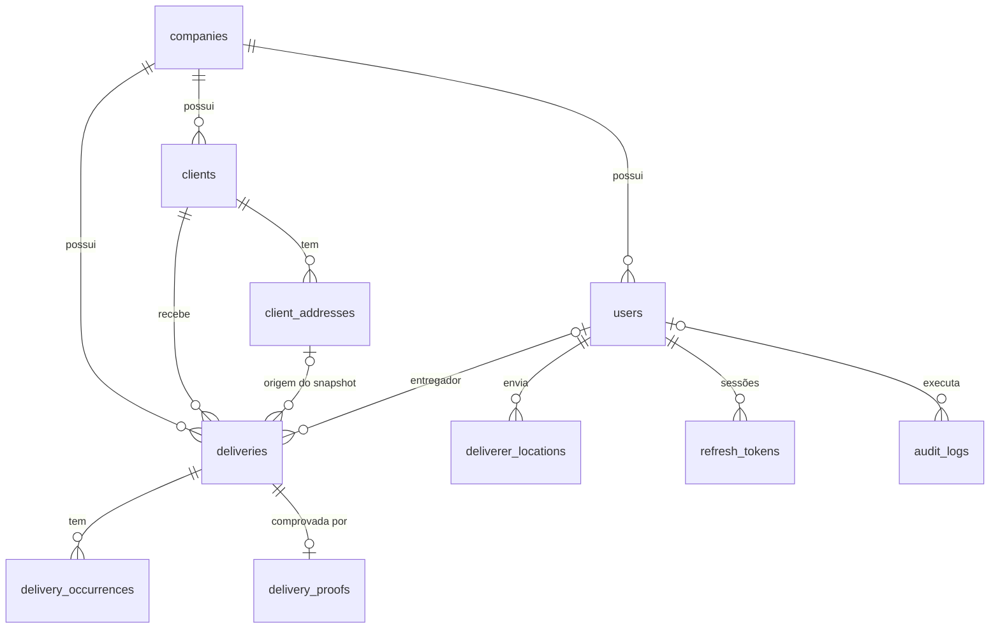

# DESPACHA — Análise Arquitetural (Fase 0)

> Documento vivo. Registra o entendimento do problema, as decisões técnicas e o
> porquê de cada uma. Decisões marcadas como **[PENDENTE]** aguardam validação.
>
> Status: decisões da Fase 0 validadas em 2026-10-06.
>
> Este repositório é público: nenhum dado de infraestrutura real (IP, domínio,
> usuários, portas, caminhos de backup) deve aparecer aqui. Use placeholders.

---

## 1. O problema

Pequenos negócios com entregadores próprios coordenam entregas por WhatsApp,
papel e memória. As dores reais:

- "Quem está levando o pedido da Dona Maria?"
- "Esse pedido já saiu?"
- "O motoboy chegou ou o cliente não estava?"
- "Quantas entregas o João fez hoje?"

O DESPACHA resolve **um ciclo**: `Cadastrar → Distribuir → Acompanhar → Finalizar`.

### O que o DESPACHA NÃO é

| Fora do escopo | Por quê | Onde vive |
|---|---|---|
| Otimização de rotas / roteirização | Problema de logística complexo | Log-Rotas |
| Navegação turn-by-turn | Google Maps/Waze já resolvem | App externo |
| Catálogo de produtos / pedidos | Isso é PDV/ERP | Sistema do lojista |
| Financeiro / fechamento de caixa | Isso é ERP | Sistema do lojista |
| Gestão de frota (veículos, manutenção) | Isso é TMS | Log-Rotas |
| Emissão de nota fiscal | Obrigação fiscal do lojista | ERP/PDV |

Valor, forma de pagamento e taxa existem na entrega **como informação
operacional** (o entregador precisa saber quanto cobrar), não como controle
financeiro.

---

## 2. Ambiguidades identificadas

Pontos que o briefing não responde e que mudam a arquitetura:

| # | Pergunta | Impacto | Recomendação |
|---|---|---|---|
| A1 | Um deploy atende **vários negócios** (SaaS multi-tenant) ou um deploy por negócio? | Modelagem inteira, segurança (IDOR entre empresas) | Multi-tenant desde o dia 1 (ADR-01) |
| A2 | Entregador **sempre** usa o app ou às vezes o operador opera por ele? | Se entregador é tabela própria ou usuário | Entregador = usuário com papel; operador também pode mudar status (ADR-06) |
| A3 | Como o entregador faz login? Nem todo motoboy tem e-mail. | Campo de login | **Decidido:** e-mail **ou** telefone (ao menos um obrigatório) |
| A4 | Um entregador leva **várias entregas na mesma saída**? | Modelo de rastreamento | Sim, assumir que sim (ADR-08) |
| A5 | De onde vêm latitude/longitude do endereço? | Custo (API de geocoding), complexidade | Opcional no MVP; navegação usa o endereço em texto (ADR-09) |
| A6 | Permissões configuráveis ou papéis fixos? | Tabelas de roles/permissions | Papéis fixos em código (ADR-05) |
| A7 | Pode existir entrega sem cliente cadastrado? | Fluxo de criação rápida | Cliente obrigatório, mas criável inline no mesmo formulário |
| A8 | Recuperação de senha por e-mail? | Exige SMTP, fluxo extra, superfície de ataque | MVP: ADMIN redefine senha; e-mail depois |
| A9 | CPF/CNPJ do cliente — qual o uso operacional? | LGPD (minimização de dados) | Campo opcional, não exibido em listagens |
| A10 | "Troco para" em pagamento em dinheiro? | Campo extra | Incluir (opcional) — é informação que o entregador realmente precisa |
| A11 | Como uma nova empresa entra no sistema? | Cadastro público = superfície de ataque | MVP: criada via comando CLI pelo dono da plataforma, sem signup público |

---

## 3. Arquitetura

### 3.1 Correção do diagrama original

O briefing coloca "React / Vite" **entre** Nginx e FastAPI. Em produção isso não
existe: o Vite só roda em desenvolvimento. No build, o React vira arquivos
estáticos (HTML/JS/CSS) que o **navegador** executa. O Nginx serve esses
arquivos e encaminha `/api` para o FastAPI.

```text
                 Navegador (React SPA)
                        │ HTTPS
                        ▼
┌──────────────────── Nginx ─────────────────────┐
│  /        → arquivos estáticos (frontend/dist) │
│  /api/*   → proxy reverso → 127.0.0.1:<porta>  │
│  TLS, headers de segurança, rate limit por IP  │
└────────────────────────┬───────────────────────┘
                         ▼
              Uvicorn (FastAPI)  ← gerenciado pelo systemd
                 │           │
                 ▼           ▼
          SQLAlchemy     Disco local (uploads, fora do webroot)
                 │
                 ▼
          PostgreSQL (escuta só localhost)
```

**Por que mesma origem (`/` e `/api` no mesmo domínio)?**

- O cookie do refresh token funciona com `SameSite=Strict` sem malabarismo.
- CORS praticamente desaparece em produção (só é necessário em dev).
- Um certificado, um domínio, menos configuração para errar.

Alternativa: API em subdomínio (`api.<dominio>`). Funciona, mas exige CORS com
credenciais e cookies `SameSite=None`/domínio compartilhado — mais superfície
para errar sem ganho real neste projeto.

### 3.2 Estrutura de pastas

```text
despacha-entregas/
├── backend/
│   ├── app/
│   │   ├── main.py              # cria o app, middlewares, routers
│   │   ├── core/                # config, segurança, db, erros, logging
│   │   └── modules/
│   │       ├── auth/            # login, refresh, logout
│   │       ├── users/
│   │       ├── companies/
│   │       ├── clients/
│   │       ├── deliveries/      # inclui máquina de estados, ocorrências, comprovantes
│   │       ├── tracking/
│   │       ├── dashboard/
│   │       └── audit/
│   ├── alembic/                 # migrations
│   ├── tests/
│   └── pyproject.toml
├── frontend/
│   └── src/
│       ├── app/                 # rotas, providers
│       ├── api/                 # cliente Axios + interceptors
│       ├── auth/
│       ├── components/ui/       # design system (Button, Input, Modal...)
│       ├── features/            # telas por domínio
│       ├── layouts/             # painel (desktop) e entregador (mobile)
│       └── styles/              # tokens, temas, reset
└── docs/
```

Cada módulo do backend tem os mesmos arquivos: `models.py`, `schemas.py`,
`router.py`, `service.py`. Ver ADR-03.

---

## 4. Decisões técnicas (ADRs)

Formato: **Problema → Decisão → Por quê → Alternativas → Trade-offs.**

### ADR-01 — Multi-tenancy com `company_id` em todas as tabelas

- **Problema:** o DESPACHA é um SaaS. Uma pizzaria nunca pode ver dados de uma
  farmácia. Adicionar multi-tenancy depois exige migrar todas as tabelas, todas
  as queries e todos os testes.
- **Decisão:** schema compartilhado; toda tabela de negócio tem `company_id`.
  O `company_id` vem **sempre do usuário autenticado**, nunca do corpo da
  requisição. Recurso de outra empresa retorna **404** (não 403), para não
  confirmar que ele existe.
- **Por quê:** custo agora é uma coluna e um filtro; custo depois é reescrever
  o sistema.
- **Alternativas:**
  - *Schema por tenant* (PostgreSQL schemas): isolamento maior, mas migrations
    multiplicadas por N tenants.
  - *Banco por tenant*: isolamento máximo, operação cara.
  - *Row Level Security (RLS)* do PostgreSQL: pode ser adicionado **depois**
    como segunda camada de defesa, sem mudar o modelo.
- **Trade-off:** um filtro esquecido vaza dados. Mitigação: helper único de
  consulta escopada + testes automatizados de isolamento entre empresas.

### ADR-02 — SQLAlchemy 2.0 síncrono + psycopg 3

- **Problema:** FastAPI suporta código async, e SQLAlchemy tem modo async.
- **Decisão:** usar o modo **síncrono** com endpoints `def` (não `async def`).
  O FastAPI executa endpoints síncronos em um thread pool automaticamente.
- **Por quê:** o modo async traz armadilhas reais (lazy loading quebra com
  `MissingGreenlet`, sessões não podem ser compartilhadas entre tasks).
  Na escala de um pequeno negócio (dezenas de requisições/minuto), o ganho de
  performance é irrelevante.
- **Alternativa:** SQLAlchemy async + asyncpg — melhor para milhares de
  conexões simultâneas ou muito I/O externo.
- **Trade-off:** se um dia houver WebSocket com milhares de conexões, essa parte
  específica pode ser async sem reescrever o resto.

### ADR-03 — Backend organizado por módulos de domínio, sem camada de Repository

- **Problema:** organizar por camada (`models/`, `schemas/`, `routers/`) espalha
  uma funcionalidade em 4 pastas. Arquiteturas "enterprise" adicionam
  Repository, UnitOfWork, DTO, Mapper... para um CRUD.
- **Decisão:** um módulo por domínio (`deliveries/`, `clients/`...) com
  `router.py` (HTTP), `service.py` (regras de negócio), `schemas.py`
  (Pydantic), `models.py` (SQLAlchemy). A `Session` do SQLAlchemy **já é** o
  repository/unit of work — não criamos outra abstração por cima.
- **Regra:** router não contém regra de negócio; service não conhece HTTP.
- **Trade-off:** trocar de ORM seria trabalhoso. Isso não vai acontecer.

### ADR-04 — Autenticação: access token JWT em memória + refresh token opaco em cookie

- **Problema:** onde guardar tokens no navegador? `localStorage` é legível por
  qualquer script — um XSS rouba a sessão.
- **Decisão:**
  - **Access token:** JWT, vida de ~15 min, guardado **em memória** (variável
    JS). Enviado no header `Authorization: Bearer`.
  - **Refresh token:** string aleatória opaca (não JWT), vida de ~7 dias, em
    cookie `HttpOnly; Secure; SameSite=Strict; Path=/api/v1/auth`. No banco
    guardamos só o **hash** (SHA-256).
  - **Rotação:** cada uso do refresh gera um novo e invalida o anterior.
  - **Detecção de reuso:** se um refresh já usado aparecer de novo, alguém o
    roubou → revogamos a família inteira (aquela sessão) e registramos evento de
    segurança.
  - Ao recarregar a página, o app chama `/auth/refresh` para obter novo access token.
  - A cada requisição o backend **recarrega o usuário do banco**: desativação
    ou troca de papel vale imediatamente, sem esperar o JWT expirar.
- **Bibliotecas:** `PyJWT` para JWT; `pwdlib` com **Argon2id** para senhas
  (recomendação atual da OWASP; `passlib` está sem manutenção).
- **Alternativas:**
  - *Sessão server-side clássica* (cookie com session id): simples e segura,
    mas o briefing pede JWT e o app mobile do entregador se beneficia de tokens.
  - *Access token em localStorage*: mais simples, vulnerável a XSS.
- **Trade-off:** mais peças (tabela `refresh_tokens`, interceptor no Axios).
  É exatamente a complexidade que compra proteção contra roubo de token.

### ADR-05 — RBAC com papéis fixos definidos em código

- **Problema:** o briefing lista tabelas `Roles/Permissions` e "gerenciar
  permissões".
- **Decisão:** três papéis fixos (`ADMIN`, `OPERATOR`, `DELIVERER`) como enum.
  O mapa papel → permissões vive no código, versionado e testado.
  "Gerenciar permissões" = ADMIN altera o papel de um usuário (auditado).
- **Por quê:** permissões dinâmicas em banco permitem configurações perigosas
  (ex.: entregador com acesso à auditoria) e exigem UI complexa. Para 3 papéis
  estáveis, isso é overengineering.
- **Alternativa:** tabelas `roles`, `permissions`, `role_permissions` — faz
  sentido quando clientes pedirem papéis customizados. A checagem no código já
  será por **permissão** (`require_permission("deliveries:assign")`), não por
  papel, então a migração futura é localizada.

### ADR-06 — Entregador é um usuário com papel `DELIVERER` (sem tabela `deliverers`)

- **Problema:** o briefing lista `Users` e `Deliverers` separados.
- **Decisão:** entregador é um registro em `users`. Se no futuro surgirem
  dados exclusivos de entregador, cria-se `deliverer_profiles` (1:1).
- **Por quê:** o entregador precisa de login → já é usuário. Duas tabelas
  significariam sincronizar nome/telefone/ativo em dois lugares.
- **Trade-off:** se um entregador **nunca** usar o app, ainda assim existe como
  usuário (sem precisar fazer login). O operador pode atualizar o status por ele.

### ADR-07 — Snapshot do endereço na entrega

- **Problema:** se a entrega apontar só para `client_address_id` e o cliente
  mudar de endereço amanhã, o histórico de ontem passa a mostrar o endereço
  errado.
- **Decisão:** a entrega **copia** nome, telefone e endereço no momento da
  criação, e mantém `client_id`/`client_address_id` como referência.
- **Por quê:** entrega é um fato histórico; fatos não mudam retroativamente.
- **Trade-off:** dado duplicado. Aqui a duplicação é intencional e correta.

### ADR-08 — Rastreamento por entregador (não por entrega), com polling

- **Problema:** um motoboy de pizzaria sai com 3 pedidos. Se a localização
  pertencer à entrega, gravamos o mesmo ponto 3 vezes.
- **Decisão:**
  - Tabela `deliverer_locations` ligada ao **entregador**. O trajeto de uma
    entrega é reconstruído pelo intervalo `started_at → delivered_at`.
  - O backend **só aceita** localização se o entregador tiver ao menos uma
    entrega `EM ROTA` (privacidade garantida no servidor, não no frontend).
  - Envio a cada ~20 s ou ~50 m de deslocamento (o que vier primeiro).
  - Painel do operador atualiza por **polling** a cada ~15 s.
  - `lat`/`lng` como `numeric(9,6)` (~10 cm de precisão). Sem PostGIS.
  - Retenção: pontos apagados após N dias (configurável) — LGPD.
- **Alternativas:** WebSocket/SSE (tempo real verdadeiro, mais infraestrutura e
  estado no servidor); PostGIS (consultas geoespaciais que não temos).
- **Trade-off:** atraso de até ~15 s no mapa. Para operação de bairro, aceitável.
- **⚠ Limitação importante:** navegador **não rastreia em segundo plano**.
  Quando o entregador abre o Google Maps, a aba do DESPACHA é suspensa (iOS
  sempre; Android geralmente) e o envio de posição para. O painel mostrará
  "última atualização há X min". A solução futura é empacotar o mesmo app React
  com Capacitor + plugin de geolocalização em background — sem reescrever.
- **Desenvolvimento:** a Geolocation API exige HTTPS (ou `localhost`). Para
  testar no celular será preciso um túnel HTTPS ou ambiente de homologação.

### ADR-09 — Sem geocoding no MVP; navegação por link externo

- **Problema:** converter endereço em lat/lng exige API externa (Google é paga;
  Nominatim/OSM é gratuita mas limitada a 1 req/s e proíbe uso intenso).
- **Decisão:** `lat`/`lng` opcionais. O botão "Navegar" abre:
  - Google Maps: `https://www.google.com/maps/dir/?api=1&destination=<endereço ou lat,lng>`
  - Waze: `https://waze.com/ul?q=<endereço>&navigate=yes`
  - Botão "Ligar para cliente" via `tel:`.
- **Mapa do operador:** Leaflet + tiles OpenStreetMap em dev; em produção, um
  provedor de tiles com plano gratuito (a política do OSM proíbe uso comercial
  intenso dos tiles oficiais). Confirmado.
- **Opcional (fase 3):** preencher endereço pelo CEP (ViaCEP, gratuito).

### ADR-10 — Arquivos (fotos/assinaturas) em disco local atrás de uma interface

- **Decisão:** módulo `storage` com uma implementação local; arquivos fora da
  pasta pública, nome = UUID aleatório; servidos **somente** por endpoint que
  verifica permissão (evita IDOR por URL adivinhável).
- **Segurança de upload:** limite de tamanho (Nginx + app); validação pelo
  conteúdo real (Pillow abre e verifica), não pela extensão; re-encode da
  imagem, o que remove metadados EXIF (que contêm GPS do celular).
- **UX:** foto redimensionada no celular antes do envio (~1280 px, JPEG) — 4G
  ruim é a realidade do entregador.
- **Alternativa:** object storage S3-compatível — trocar a implementação depois
  sem tocar no resto. Backups precisam incluir a pasta de uploads.

### ADR-11 — Sem Docker no MVP

- **Contexto:** PostgreSQL já instalado localmente; deploy em um único VPS.
- **Decisão:** dev com PostgreSQL local; produção com serviços nativos
  (Nginx, PostgreSQL, Uvicorn via systemd).
- **Por quê:** menos camadas para aprender e depurar; você aprende Linux, systemd
  e Nginx de verdade.
- **Alternativa:** Docker Compose — ambiente idêntico dev/prod, isolamento,
  rollback por imagem. Custo: mais uma tecnologia, volumes e redes para
  entender. Pode ser adotado depois sem mudar o código.
- **Atenção:** manter a mesma versão *major* do PostgreSQL em dev e produção.

### ADR-12 — CSS Modules + design tokens em CSS Variables

- **Problema:** CSS global em projeto grande gera colisão de classes e medo de
  apagar estilos.
- **Decisão:** cada componente tem seu `Componente.module.css` (escopo
  automático, suporte nativo do Vite — continua sendo CSS puro). Cores,
  espaçamentos, raios, sombras e tipografia vêm de tokens globais
  (`--color-*`, `--space-*`...). Componentes **nunca** usam cor hex direta.
- **Temas:** `<html data-theme="light|dark">`, padrão segue
  `prefers-color-scheme`, escolha salva no navegador.
- **Alternativa:** CSS global com convenção BEM — ensina disciplina de nomes,
  mas a proteção contra colisão depende só de disciplina.

### ADR-13 — Auditoria desde a fase 2, append-only garantido pelo banco

- **Problema:** o plano original deixa auditoria para a fase 9. Inserir chamadas
  de auditoria em dezenas de endpoints prontos é onde nascem as lacunas.
- **Decisão:** tabela e serviço de auditoria criados na fase 2 (já registrando
  login/logout/falha). Cada fase seguinte audita suas ações. A fase 9 entrega a
  tela de consulta e o endurecimento.
- **Append-only real:** o usuário do banco usado pela aplicação recebe apenas
  `INSERT` e `SELECT` em `audit_logs` (sem `UPDATE`/`DELETE`). Nem um bug nem
  uma invasão da aplicação conseguem apagar rastros.
- **Menor privilégio no banco:** dois usuários PostgreSQL — um dono do schema
  (usado só pelas migrations) e um da aplicação (somente DML necessário).

### ADR-14 — Outras convenções

- **Migrations:** Alembic (ferramenta oficial do SQLAlchemy). Nenhuma mudança
  de schema manual.
- **IDs:** UUID como chave primária (não expõe volume nem facilita
  enumeração). Entregas também têm `number` sequencial **por empresa** para
  humanos ("Entrega #482").
- **Datas:** `timestamptz` em UTC no banco; cada empresa tem fuso horário
  (padrão `America/Sao_Paulo`) para calcular "hoje" corretamente.
- **Dinheiro:** `numeric(10,2)` / `Decimal`. Nunca `float`.
- **API versionada:** `/api/v1/...`.
- **Idioma:** código, tabelas e enums em inglês; interface em português.
- **Gerenciador Python:** `uv` (lockfile reproduzível, instala a versão do
  Python). Alternativa descartada: `venv` + `pip` + `requirements.txt`.
- **Versão do Python:** 3.14, fixada em `backend/.python-version`. O `uv`
  instala exatamente essa versão no VPS, independente do Python do sistema.
- **Testes:** `pytest` contra um PostgreSQL de teste real (SQLite se comporta
  diferente). Testes de autorização (IDOR, papéis) são obrigatórios.

---

## 5. Modelagem de dados (proposta)

10 tabelas. Comparado ao briefing: **removidas** `roles`, `permissions` e
`deliverers` (ADR-05, ADR-06); **adicionadas** `companies` (ADR-01) e
`refresh_tokens` (ADR-04); `DeliveryLocations` virou `deliverer_locations`
(ADR-08).



### companies
`id`, `name`, `timezone`, `settings` (JSONB validado por Pydantic: exigir foto /
assinatura / nome do recebedor, retenção de localização), `next_delivery_number`,
`is_active`, `created_at`, `updated_at`

### users
`id`, `company_id`, `name`, `email`? (único), `phone`? (único) — ao menos um
dos dois é obrigatório (CHECK no banco); o login aceita qualquer um, `password_hash`, `role` (`ADMIN | OPERATOR | DELIVERER`), `is_active`,
`failed_login_count`, `locked_until`, `last_login_at`, `password_changed_at`,
`created_at`, `updated_at`

### refresh_tokens
`id`, `user_id`, `family_id`, `token_hash`, `expires_at`, `used_at`,
`revoked_at`, `created_at`, `ip`, `user_agent`

### clients
`id`, `company_id`, `name`, `phone`, `email`?, `document`? (CPF/CNPJ),
`notes`?, `is_active`, `created_at`, `updated_at`

### client_addresses
`id`, `company_id`, `client_id`, `label`? ("Casa", "Trabalho"), `zip_code`?,
`street`, `number`, `complement`?, `neighborhood`, `city`, `state`,
`reference`? (ponto de referência — ouro para o entregador), `lat`?, `lng`?,
`is_default`, `created_at`, `updated_at`

### deliveries
- Identificação: `id`, `company_id`, `number`
- Origem: `client_id`, `client_address_id`?
- Snapshot: `recipient_name`, `recipient_phone`, campos de endereço, `lat`?, `lng`?
- Operação: `notes`?, `order_amount`?, `payment_method`, `change_for`?,
  `delivery_fee`?, `deliverer_id`?, `status`, `cancel_reason`?
- Tempo: `created_at`, `expected_at`?, `assigned_at`?, `started_at`?,
  `delivered_at`?, `canceled_at`?, `updated_at`
- Autoria: `created_by`

`payment_method`: `CASH | PIX | CREDIT_CARD | DEBIT_CARD | PREPAID | OTHER`

> As colunas de tempo formam a **linha do tempo** da entrega sem precisar de
> uma tabela de histórico de status. Trocas de entregador ficam na auditoria.

### delivery_occurrences
`id`, `company_id`, `delivery_id`, `reported_by`, `type`, `description`?,
`lat`?, `lng`?, `photo_path`?, `created_at`

`type`: `CUSTOMER_ABSENT | WRONG_ADDRESS | REFUSED | ACCESS_PROBLEM |
DAMAGED_PRODUCT | DELIVERY_PROBLEM | OTHER`

### delivery_proofs (1:1 com entrega)
`id`, `company_id`, `delivery_id` (único), `received_by_name`?, `photo_path`?,
`signature_path`?, `notes`?, `lat`?, `lng`?, `created_by`, `created_at`

### deliverer_locations (alto volume → `bigint` como PK)
`id`, `company_id`, `user_id`, `lat`, `lng`, `accuracy_m`?, `recorded_at`
(relógio do celular), `received_at` (relógio do servidor)

Índice: `(user_id, recorded_at DESC)` — "última posição de cada entregador"
via `DISTINCT ON`. Volume estimado: 100 entregas/dia × 30 min × 3 pontos/min ≈
9 mil linhas/dia. Trivial para o PostgreSQL.

### audit_logs (append-only, `bigint` como PK)
`id`, `company_id`?, `user_id`?, `action` (ex.: `auth.login_failed`,
`delivery.status_changed`), `resource_type`?, `resource_id`?, `ip`,
`user_agent`, `details` (JSONB — nunca senhas/tokens), `created_at`

Índice: `(company_id, created_at DESC)`.

`?` = campo opcional (nullable).

---

## 6. Máquina de estados da entrega

```text
            ┌──────────────── CANCELADA ◄──────────────┐
            │                    ▲                     │
PENDENTE ──►ATRIBUÍDA ──► EM ROTA ──► ENTREGUE         │
   ▲           │  ▲          │  ▲                      │
   └───────────┘  │          ▼  │                      │
                  └──────── OCORRÊNCIA ────────────────┘
```

| De | Para | Quem pode | Regra |
|---|---|---|---|
| PENDENTE | ATRIBUÍDA | Admin, Operador | Entregador ativo da mesma empresa |
| PENDENTE | CANCELADA | Admin, Operador | Motivo obrigatório |
| ATRIBUÍDA | ATRIBUÍDA | Admin, Operador | Troca de entregador (auditada) |
| ATRIBUÍDA | PENDENTE | Admin, Operador | Desatribuir |
| ATRIBUÍDA | EM ROTA | Entregador atribuído, Admin, Operador | |
| ATRIBUÍDA | CANCELADA | Admin, Operador | Motivo obrigatório |
| EM ROTA | ENTREGUE | Entregador atribuído, Admin, Operador | Comprovante conforme configuração da empresa |
| EM ROTA | OCORRÊNCIA | Entregador atribuído, Admin, Operador | Cria registro em `delivery_occurrences` |
| EM ROTA | CANCELADA | Admin, Operador | Motivo obrigatório |
| OCORRÊNCIA | EM ROTA | Entregador atribuído, Admin, Operador | Retomar (ex.: cliente apareceu) |
| OCORRÊNCIA | PENDENTE / ATRIBUÍDA | Admin, Operador | Redistribuir |
| OCORRÊNCIA | ENTREGUE | Admin, Operador | Resolvido fora do fluxo normal |
| OCORRÊNCIA | CANCELADA | Admin, Operador | Motivo obrigatório |

`ENTREGUE` e `CANCELADA` são finais.

- As transições ficam num **único lugar** no código (dicionário de transições
  permitidas + checagem de papel). Nenhum endpoint muda `status` diretamente.
- **Concorrência:** operador cancela enquanto entregador finaliza. A transição
  usa `SELECT ... FOR UPDATE` na linha da entrega; a segunda operação vê o novo
  estado e é rejeitada com `409 Conflict`.
- `OCORRÊNCIA` significa "precisa de atenção do operador" — aparece em
  destaque no dashboard.

---

## 7. Fluxos principais

### 7.1 Operador cria entrega (precisa ser rápido)

1. Digita telefone ou nome → busca cliente.
2. Encontrou: escolhe o endereço (padrão pré-selecionado).
   Não encontrou: cadastra cliente + endereço **no mesmo formulário**.
3. Informa valor, forma de pagamento, troco, taxa, observação.
4. Opcional: já atribui entregador.
5. Salvar → entrega aparece na coluna correspondente da tela de operação.

### 7.2 Entregador

```text
Minhas entregas (atual no topo)
  → Detalhe: endereço + referência + valor/troco + [Navegar] [Ligar]
  → [Iniciar entrega]        → status EM ROTA, começa envio de posição
  → [Finalizar]              → comprovante (campos conforme configuração)
     ou [Registrar ocorrência]
  → Sem entregas em rota     → envio de posição para
```

Botões grandes (mínimo 48 px de altura), um polegar, poucas telas.

### 7.3 Login e renovação de sessão

```text
POST /auth/login (email+senha)
  ├─ falha → mensagem genérica, contador de falhas, auditoria
  └─ ok    → access token (corpo) + refresh token (cookie HttpOnly)

Requisição com access expirado → 401
  → Axios chama POST /auth/refresh UMA vez (fila para requisições paralelas)
  → novo access + novo refresh (rotação) → repete a requisição original
  → refresh falhou → logout
```

---

## 8. Segurança: ameaças e mitigações

| Ameaça | Mitigação |
|---|---|
| **IDOR / acesso entre empresas** | `company_id` sempre do token; consultas escopadas por helper único; entregador só vê entregas onde `deliverer_id = ele`; 404 para recurso alheio; testes automatizados |
| **Broken Access Control** | Permissão checada no backend em toda rota (`Depends`); frontend só esconde botões (UX, não segurança) |
| **Mass Assignment** | Schemas separados `Create`/`Update`/`Out`; `extra="forbid"`; `company_id`, `role`, `status` nunca aceitos de quem não pode alterá-los |
| **Brute force** | Rate limit por IP no Nginx (vale para todos os workers) + bloqueio progressivo por conta no banco (`failed_login_count`, `locked_until`) |
| **Credential stuffing** | Limite por IP independente da conta; auditoria de falhas; regra de senha mínima |
| **User enumeration** | Mesma mensagem e **mesmo tempo** de resposta para usuário inexistente (verifica contra hash fictício) |
| **Roubo / reuso de token** | Access curto em memória; refresh HttpOnly com rotação e detecção de reuso; logout e troca de senha revogam sessões |
| **CSRF** | API usa header `Authorization` (imune); endpoint de refresh usa cookie `SameSite=Strict` + verificação do header `Origin` |
| **XSS** | React escapa por padrão; proibido `dangerouslySetInnerHTML`; CSP restritiva; token fora do `localStorage` |
| **SQL Injection** | Só ORM / queries parametrizadas; campos de ordenação em lista branca |
| **Vazamento de informação** | Handler global de erros: resposta genérica + `request_id`; stack trace só no log do servidor; `/docs` desabilitado em produção |
| **Upload malicioso** | Validação por conteúdo, limite de tamanho, re-encode, nome aleatório, fora do webroot, download com checagem de permissão |
| **IP falsificado** (burla rate limit e auditoria) | Uvicorn só confia em `X-Forwarded-For` vindo do Nginx local |
| **Adulteração de auditoria** | Usuário de banco da aplicação sem `UPDATE`/`DELETE` em `audit_logs` |
| **Segredos expostos** | Variáveis de ambiente; `.env` no `.gitignore`; apenas `.env.example` com placeholders é versionado |
| **Privacidade do entregador (LGPD)** | Posição aceita só com entrega em rota; aviso claro no app; retenção limitada |

Headers de segurança: `Strict-Transport-Security`, `Content-Security-Policy`,
`X-Content-Type-Options: nosniff`, `Referrer-Policy`,
`Permissions-Policy` (geolocation e câmera só da própria origem),
`frame-ancestors 'none'`.

Formato único de erro da API:

```json
{ "error": { "code": "DELIVERY_INVALID_TRANSITION", "message": "...", "request_id": "..." } }
```

---

## 9. Frontend e direção visual

### Duas experiências distintas

| | Painel (Admin/Operador) | App do Entregador |
|---|---|---|
| Dispositivo | Desktop primeiro, responsivo | Celular primeiro |
| Navegação | Sidebar + topo | Tela única com ações grandes |
| Densidade | Média-alta (operação) | Baixa (uso na rua, sol, uma mão) |

### Telas do painel

- **Painel** — indicadores do dia + lista "Precisa de atenção" (ocorrências,
  pendentes há muito tempo, entregas atrasadas). Responde: *o que preciso fazer
  agora?* Sem gráficos decorativos.
- **Operação** — colunas por status (Pendentes, Atribuídas, Em rota,
  Ocorrências). Atribuição por clique (sem drag-and-drop no MVP).
- **Mapa** — entregadores ativos, última atualização, entrega atual.
- **Clientes**, **Histórico** (filtros), **Usuários**, **Auditoria**,
  **Configurações** (estas três só Admin).

### Identidade

- **Claro:** fundo branco/cinza muito claro, azul claro como identidade,
  laranja reservado para ação principal e destaques.
- **Escuro:** cinza escuro (não preto puro), laranja como cor principal, azul
  claro secundário. Projetado à parte — não é inversão do claro.
- **Contraste:** texto branco sobre laranja médio não atinge 4.5:1 em texto
  normal; o tema escuro usará texto escuro sobre laranja nos botões
  principais. Todos os pares de cor serão verificados (WCAG AA).
- **Ícones:** SVG (biblioteca Lucide). Sem emoji como ícone.
- **Movimento:** transições de 150–250 ms, só onde comunicam algo;
  `prefers-reduced-motion` respeitado.
- Status sempre com **cor + texto + ícone** (nunca só cor).

### Decisões da Fase 1

- **Fonte:** Manrope (variável), **hospedada junto com o app** via
  `@fontsource-variable`. Google Fonts por CDN enviaria o IP de cada usuário
  ao Google (LGPD) e exigiria liberar outro domínio na CSP.
- **Laranja do tema claro:** `#CC4A0C`. O laranja "padrão" `#EA580C` com texto
  branco dá 3.56:1 e reprova no WCAG AA (mínimo 4.5:1); `#CC4A0C` dá 4.61:1.
- **Tema escuro:** botão principal `#FB923C` com texto escuro (8.19:1), em vez
  de texto branco.
- **Bordas de input:** 3:1 contra o fundo (WCAG 1.4.11), nos dois temas.
- **CSS:** tokens em duas camadas (primitivos → semânticos) em
  `frontend/src/styles/tokens.css`; componentes usam só os semânticos.
- **Tema sem "flash":** `public/theme-init.js` aplica o tema antes do React
  carregar (arquivo externo, compatível com CSP `script-src 'self'`).

---

## 10. Ajustes propostos ao plano de fases

| Fase | Ajuste |
|---|---|
| 1 — Fundação | + `companies`, Alembic, pytest, `.env.example`, tokens CSS e temas, comando CLI para criar empresa + admin |
| 2 — Autenticação | + infraestrutura de auditoria (ADR-13); testes de segurança do login |
| 3 — Clientes | + CEP automático (opcional) |
| 4 — Entregas | Máquina de estados centralizada + testes de transição e concorrência |
| 5 — Entregador | Inclui finalização com comprovante simples (nome); foto/assinatura na fase 7 |
| 6 — Rastreamento | Inclui job de retenção de localizações |
| 8 — Dashboard | "Precisa de atenção" como peça central; relatório simples por entregador |
| 9 — Auditoria | Vira: tela de auditoria + revisão de segurança geral |
| 10 — Produção | Restauração de backup **testada** faz parte do critério de pronto |

Cada fase termina com commit próprio.

---

## 11. Riscos conhecidos

| Risco | Probabilidade | Resposta |
|---|---|---|
| GPS para quando entregador abre o Maps | Alta | Mostrar "última atualização"; futuro: Capacitor |
| Conexão ruim do entregador | Alta | Fotos comprimidas; reenvio automático; feedback claro de erro |
| Filtro de `company_id` esquecido | Média | Helper único + testes de isolamento + RLS futuro |
| Escopo crescer para ERP/roteirização | Média | Seção 1 deste documento; pergunta "isso pertence ao DESPACHA?" |
| Backup que não restaura | Média | Teste de restauração periódico e documentado |

---

## 12. Decisões de implementação — Fase 2 (Autenticação)

| Tema | Decisão | Por quê |
|---|---|---|
| Hash de senha | Argon2id com parâmetros mínimos da OWASP (19 MiB, t=2, p=1) | O padrão da biblioteca (64 MiB) com dezenas de logins simultâneos esgotaria a memória de um VPS pequeno |
| Tempo constante | Usuário inexistente também passa por uma verificação de hash | Sem isso, a resposta mais rápida revelaria quais e-mails existem |
| Mensagem de falha | Idêntica para usuário inexistente, senha errada, conta bloqueada ou inativa | Evita enumeração de contas |
| Bloqueio | Progressivo por conta (15 min, 30, 60… até 24 h), linha travada com `SELECT … FOR UPDATE` | Tentativas paralelas não "furam" o contador |
| Rate limit | Em memória por processo + Nginx global (fase 10) | Sem Redis no MVP; as duas camadas se complementam |
| Refresh no navegador | Uma renovação por vez: Promise compartilhada na aba + Web Locks API entre abas | Duas renovações simultâneas com o mesmo cookie pareceriam roubo de token |
| Logout entre abas | `BroadcastChannel` encerra a sessão nas outras abas | Access token em memória continuaria válido até expirar |
| Troca de senha | Tokens com `iat` anterior a `password_changed_at` são recusados; outras sessões revogadas | Senha comprometida deixa de valer em todos os dispositivos |
| Usuário a cada requisição | Recarregado do banco (papel, status, empresa) | Desativar alguém vale na hora, não em 15 minutos |
| CSRF | Cookie `SameSite=Strict` + verificação do header `Origin` nas rotas com cookie | Defesa em camadas |
| Mensagens de validação | Traduzidas no handler de erro (Pydantic responde em inglês) | Mensagem clara para quem preenche o formulário |
| Diálogos e menus | `<dialog>` nativo e Popover API | Foco preso, Esc, fundo inerte e devolução de foco sem bibliotecas |
| Pós-login | Volta para a página pedida só se for interna e o perfil puder acessá-la | Evita redirecionamento para fora e telas de "acesso negado" |
| Senhas no terminal | CLI nunca recebe senha por argumento (prompt ou `--password-stdin`) | Argumentos ficam no histórico do shell e na lista de processos |

## 13. Decisões de implementação — Fase 3 (Clientes)

| Tema | Decisão | Por quê |
|---|---|---|
| Campos obrigatórios | Só o nome do cliente; no endereço, rua, número, bairro, cidade e UF | Coletar o mínimo necessário (LGPD e agilidade) |
| CPF/CNPJ | Opcional, validado pelos dígitos verificadores, fora das listagens | Dado sensível sem uso operacional na maioria dos negócios |
| Endereço principal | Índice único parcial (`WHERE is_default`) no PostgreSQL | A regra "só um principal" vale mesmo com requisições simultâneas |
| `company_id` no endereço | Repetido na tabela de endereços | Filtro por empresa sem JOIN; isolamento simples |
| IDOR em endereço | Endereço é buscado dentro do cliente da URL, já validado | Id de endereço de outro cliente não é encontrado |
| Busca | Nome (ILIKE) ou dígitos do telefone (a partir de 4) | É assim que o operador procura no balcão |
| Excluir cliente | Arquivar (`is_active`), nunca apagar | Entregas antigas continuam referenciando o cliente |
| CEP | ViaCEP direto do navegador, timeout de 4 s, falha silenciosa | Acelera o cadastro sem virar dependência; **liberar `viacep.com.br` no `connect-src` da CSP na fase 10** |

## 14. Decisões de implementação — Fase 4 (Entregas)

| Tema | Decisão | Por quê |
|---|---|---|
| Mudança de status | Ações explícitas (`/assign`, `/start`, `/complete`, `/cancel`, `/unassign`) sobre uma máquina de estados única | Impossível pular etapas; cada regra vive num lugar só |
| Concorrência | `SELECT … FOR UPDATE` na entrega em toda transição | Cancelar e finalizar ao mesmo tempo: o segundo recebe 409 |
| Número da entrega | `UPDATE companies … RETURNING` | `MAX()+1` duplicaria números sob concorrência |
| Dinheiro | `Numeric(10,2)` no banco, `Decimal` no Python, texto no JSON, formatação só na tela | Float erra centavos |
| Edição | Bloqueada em entregas finalizadas; endereço trava quando sai para entrega | O entregador não pode ser surpreendido no caminho |
| Quadro de operação | Colunas por etapa, mais antigas no topo, polling de 15 s só com a aba visível | Responde "o que precisa de atenção agora" sem WebSocket |
| Atribuição | Lista de entregadores mostra a carga atual ("2 em andamento") | Distribuir melhor sem virar roteirizador (isso é Log-Rotas) |
| Nova entrega | Um formulário só: cliente (busca ou cadastro na hora) → endereço → pagamento → previsão rápida | Velocidade no balcão |
| Formulários aninhados | Escolha de cliente fora do `<form>` da entrega | Form dentro de form faria um envio disparar o outro |
| Foco em diálogos | `data-autofocus` no primeiro campo | O `<dialog>` focaria o botão Fechar; o `autoFocus` do React não vira atributo |
| Models × migrations | CHECKs de enum explícitos + teste com `alembic check` | Evita constraint duplicada e migration esquecida |

## 15. Decisões de implementação — Fase 5 (Área do entregador)

| Tema | Decisão | Por quê |
|---|---|---|
| Rotas do entregador | `/me/deliveries`, separadas, filtrando `deliverer_id = usuário logado` em toda consulta | Um "if entregador" esquecido numa rota compartilhada vira IDOR |
| Passos permitidos | Entregador só inicia, finaliza, registra ocorrência e retoma (as próprias) | Menor privilégio: cancelar e redistribuir é decisão do operador |
| Comprovante | Tabela `delivery_proofs` (1 por entrega): quem recebeu, observação, localização | Foto e assinatura entram na fase 7 sem mudar o fluxo |
| Ocorrência | Tabela `delivery_occurrences`; registrar move a entrega para `ISSUE` | O operador vê no quadro o que precisa de atenção |
| Localização | Pontual e opcional, só ao finalizar ou registrar ocorrência | Rastreamento contínuo é a fase 6; GPS negado não bloqueia o trabalho |
| Interface | Uma tela por entrega; endereço grande; Maps, Waze e ligar em botões grandes; ação principal fixa no rodapé com área segura | Uso com uma mão, na rua, com pressa |
| Cobrança | Texto direto ("Cobrar R$ 58,90 · Dinheiro · levar R$ 41,10") com troco calculado em centavos inteiros | Erro de centavo vira prejuízo no fim do dia |
| Testes do frontend | Vitest + Testing Library; lógica pura em ambiente `node` | Regras de dinheiro e permissão com rede de segurança automática |

## 16. Decisões de implementação — Fase 6 (Rastreamento)

| Tema | Decisão | Por quê |
|---|---|---|
| Privacidade | Servidor só grava posição com entrega `IN_ROUTE`/`ISSUE`; fora disso descarta e responde `tracking=false` | A regra de "não rastrear fora da operação" não pode depender do app |
| Quando ligar o GPS | App consulta `GET /me/tracking` (a cada 30 s e logo após iniciar/finalizar) | GPS ligado só quando necessário: bateria e privacidade |
| Frequência | 20 s ou 50 m (haversine), o que vier primeiro; rate limit de 12/min por entregador no servidor | Mapa útil sem inundar o banco |
| Relógio do celular | Fora de [-1 h, +2 min] do servidor, vale o horário do servidor | Celulares com hora errada bagunçariam a "última posição" |
| Última posição | `DISTINCT ON (user_id)` com índice `(user_id, recorded_at)` | Uma consulta para todos os entregadores |
| Mapa | Leaflet + tiles configuráveis (`VITE_MAP_TILE_URL`), marcador com iniciais via `divIcon`, carregado sob demanda | Sem custo de API paga; sem ícones quebrados no bundle; Leaflet fora do bundle principal |
| Sinal antigo | Sem posição há 5 min: marcador esmaecido + "sem sinal recente" | Navegador suspende a página quando o entregador abre o Maps (limitação do ADR-08) |
| Retenção | `python -m app.cli purge-locations` (padrão 30 dias, `LOCATION_RETENTION_DAYS`) | LGPD: localização é dado pessoal; agendado na fase 10 |
| Transparência | Selo "Localização ativa" no topo e aviso na lista do entregador | O entregador sabe quando está sendo acompanhado |

## 17. Decisões de implementação — Fase 7 (Comprovantes)

| Tema | Decisão | Por quê |
|---|---|---|
| Fluxo | Upload dos arquivos primeiro (`POST …/files`), finalização depois; a finalização confere as exigências | Rede caiu no meio? Nada é finalizado sem comprovante; basta tentar de novo |
| Validação de imagem | Conteúdo real via Pillow (`verify` + `load`), formatos JPEG/PNG/WebP, limite de 40 Mpx e de tamanho | Extensão e Content-Type enviados pelo cliente mentem; decompression bomb derruba servidor |
| Recodificação | Foto → JPEG 82% até 1600 px; assinatura → PNG; nenhum EXIF copiado | Remove GPS/modelo do aparelho e qualquer conteúdo escondido no arquivo |
| Nome no disco | `{empresa}/{ano}/{mês}/{uuid}.{ext}` gerado pelo servidor, fora da pasta pública | Sem path traversal; nome não revela o cliente |
| Download | `GET /files/{id}` confere empresa e dono; 404 para quem não pode ver | Arquivo é dado pessoal; URL adivinhada não basta |
| Exibição no navegador | Axios baixa com o token e a página mostra via `blob:` | `` não envia o header `Authorization`; **liberar `blob:` em `img-src` na CSP (fase 10)** |
| Compressão no celular | `createImageBitmap` + canvas → JPEG antes de enviar | ~4 MB viram ~200 KB: essencial em 4G ruim |
| Assinatura | Canvas com Pointer Events, `touch-action: none`, resolução real da tela, fundo branco | Toque, caneta e mouse com o mesmo código; traço nítido; documento legível em qualquer tema |
| Exigências | Configuráveis pelo admin (nome, foto, assinatura); valem para o entregador; operador finaliza por exceção (auditado) | Cada negócio tem uma necessidade (farmácia ≠ pizzaria) |
| Testes | Sessão de teste faz rollback em erro, como a sessão real | Um teste revelou estado "sujo" vazando entre requisições |

## 18. Decisões de implementação — Fase 8 (Painel, histórico e relatórios)

| Tema | Decisão | Por quê |
|---|---|---|
| Forma do painel | Stat tiles + lista "Precisa de atenção"; nenhum gráfico | A pergunta é "o que está acontecendo agora?", e a resposta é um número, não uma tendência |
| Comparação | "Entregas hoje" vs. **ontem até o mesmo horário** | Comparar dia parcial com dia inteiro sempre pareceria queda |
| "Precisa de atenção" | Ocorrências → atrasadas → pendentes há mais de 15 min, mais antigas primeiro, com link direto para a entrega | Responde "o que faço agora?" sem caçar no quadro |
| Hoje | Limites do dia calculados no fuso da empresa | Meia-noite em São Paulo é 03:00 UTC |
| Relatório por entregador | Entregues e taxas pela data de entrega; canceladas e ocorrências pela data do fato; até 93 dias | É o "acerto do dia" com o motoboy, sem virar sistema financeiro |
| Exportação CSV | `;` + vírgula decimal + UTF-8 com BOM (Excel brasileiro); células iniciadas por `= + - @` prefixadas com `'` | Abre certo no Excel e não executa fórmula maliciosa (CSV injection) |
| Minimização na exportação | Sem telefone nem endereço completo; exportação auditada | Exportar dados pessoais em massa é ação sensível (LGPD) |
| Histórico | Mesmo endpoint de entregas com filtros (período, status, entregador, busca), paginação de 50 | Sem duplicar API; sem BI |

## 19. Decisões de implementação — Fase 9 (Auditoria e segurança)

| Tema | Decisão | Por quê |
|---|---|---|
| Consulta de auditoria | `GET /audit` só para admin, filtros por categoria/usuário/período, somente leitura | Responder "quem fez o quê e quando" sem abrir brecha para alterar registros |
| Encerrar sessões | Revoga refresh tokens e marca `sessions_revoked_at`; tokens emitidos antes são recusados | Celular perdido/roubado perde o acesso na hora, não em 15 min |
| `iat` fracionário | Timestamp com fração de segundo no JWT | Revogação no mesmo segundo da emissão também vale |
| Limpeza | `purge-sessions` remove sessões vencidas/revogadas antigas | Tabela de sessões não cresce para sempre |
| Travas de produção | Recusa CORS sem https e `DEV_SEED_PASSWORD` em produção | Configuração perigosa falha cedo, na inicialização |
| HTML cru | `escapeHtml` onde uma biblioteca exige string HTML (Leaflet) | O React escapa sozinho; bibliotecas externas não |
| Revisão | Ver [SEGURANCA.md](SEGURANCA.md): método, achados, riscos aceitos e pendências de produção | Segurança documentada e repetível |

## 20. Decisões de implementação — Fase 10 (Produção)

Tudo versionado em [`deploy/`](../deploy/), com placeholders. O runbook é o
[deploy/README.md](../deploy/README.md).

| Tema | Decisão | Por quê | Alternativa descartada |
|---|---|---|---|
| Hospedagem | Um VPS: Nginx + Uvicorn (systemd) + PostgreSQL local | Custo e operação compatíveis com um pequeno negócio; poucas peças móveis | Kubernetes/PaaS: complexidade e custo sem ganho nesse porte |
| Containers | Sem Docker no servidor | systemd já dá isolamento (sandbox), reinício e logs; um processo a menos para manter | Docker Compose: válido, mas acrescenta camada de rede/volumes e atualização de imagens |
| Processo da API | Uvicorn com 2 workers, só em `127.0.0.1`, sandbox do systemd (`ProtectSystem=strict`, sem capabilities) | Se a API for invadida, o estrago fica contido: não grava no disco além dos uploads | Gunicorn + workers Uvicorn: sem ganho real para este porte |
| Credenciais do banco | `backend.env` (API, só `despacha_app`) separado de `migrations.env` (dono do schema) | A API em execução nunca tem permissão para alterar tabelas nem a auditoria | Um arquivo só: a credencial de DDL ficaria no ambiente do processo exposto |
| Arquivos de ambiente | Lidos pelo systemd (`EnvironmentFile`), inclusive nas migrations e na CLI via `systemd-run` | Um único parser, sem `source` no shell (valores com `&`, `$` etc. não quebram nem executam) | `source` no shell: frágil e arriscado |
| Scripts de operação | Instalados em `/usr/local/sbin` (dono root) após revisão; o deploy avisa quando mudam | O checkout pertence ao usuário da aplicação: se o root executasse dali, uma dependência maliciosa no build viraria root | Executar direto do repositório |
| Build do frontend | `npm ci --ignore-scripts` no servidor, como usuário sem privilégios; saída copiada para uma pasta de release do root | Nenhum pacote executa código na instalação; nenhuma dependência do projeto precisa disso no Linux | Build no CI com envio de artefato: melhor no futuro, mas exige credencial de deploy |
| Frontend | Releases com data e commit + link simbólico `current` trocado de forma atômica | Deploy sem tela quebrada pela metade; rollback instantâneo | Sobrescrever a pasta: janela de arquivos misturados |
| Migrations | Rodam antes do reinício, com a regra *expand → contract* | Deploy sem janela de manutenção | Parar a API durante o deploy |
| HTTPS | Let's Encrypt com renovação via webroot; TLS 1.2/1.3 declarado no próprio site | Renova sem derrubar o Nginx; não depende de arquivos gerados pelo plugin do certbot | `certbot --nginx`: edita a configuração versionada |
| Headers | CSP estrita (`style-src 'self'`), HSTS, `Permissions-Policy` restrita, repetidos onde há `add_header` local | Defesa em profundidade contra XSS, clickjacking e vazamento de referer | `'unsafe-inline'` em estilos: desnecessário (o Leaflet usa CSSOM) |
| Rate limit | Nginx por IP (auth 10/min; API 20/s) + limite em memória da app | O limite da app é por processo; o do Nginx é global | Redis: mais uma peça para operar |
| Backup | `pg_dump -Fc` + tar dos uploads, cifrado com `age` para 2 chaves (dono offline + servidor), cópia externa com `rclone` | Recupera tudo mesmo com o servidor perdido; o provedor externo só vê dados cifrados | Snapshot do provedor: útil como extra, mas preso ao provedor e sem garantia de consistência do banco |
| Teste de restauração | Mensal e automático: restaura num banco temporário, confere migrations e contagens, apaga | Backup que nunca foi restaurado não é confiável | Teste manual "quando lembrar" |
| Manutenção | Timers diários de `purge-locations` (LGPD) e `purge-sessions` | Retenção mínima de dados pessoais sem depender de alguém lembrar | Cron: timers têm `Persistent=` (rodam se o servidor estava desligado) e logs no journal |
| Monitoramento | Monitor externo em `/api/v1/health` + pings dos timers (backup, restauração) | Alerta quando algo para, inclusive quando o servidor inteiro cai | Stack de observabilidade completa: desproporcional ao porte |
| CI | GitHub Actions: ruff, pytest com PostgreSQL real, oxlint, Prettier, Vitest, build, `pip-audit`, `npm audit` | Nada quebrado ou vulnerável chega à `main` sem aviso; sem segredos (senhas geradas no job) | Testes só locais |

